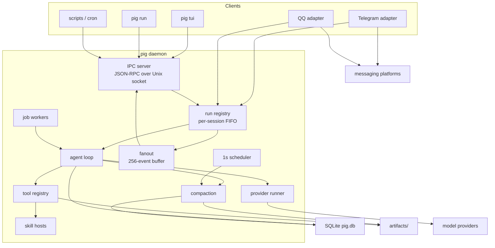
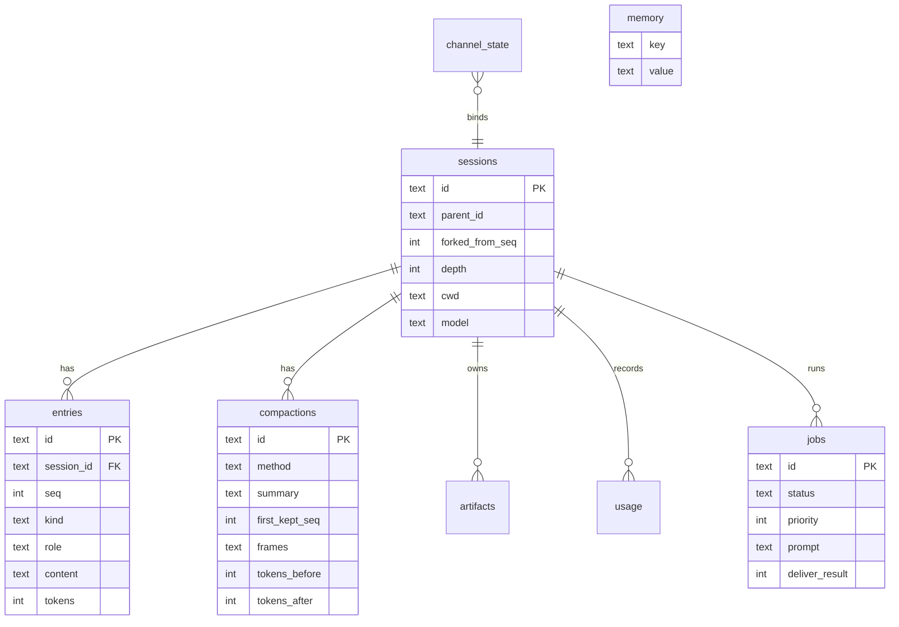
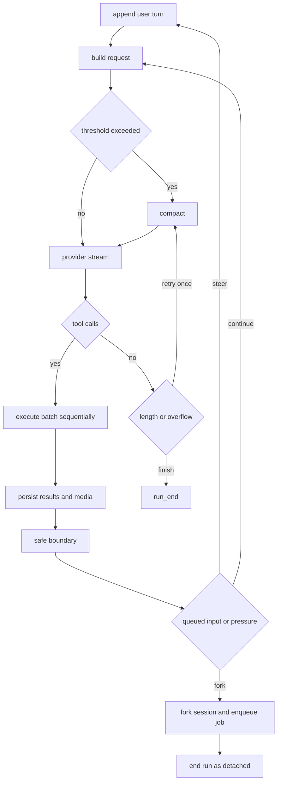

# Architecture

Pig is one Go binary that runs as a single long-lived daemon. The terminal UI,
`pig run`, the messaging channels and any script are clients of that daemon over
a Unix socket. Nothing else holds state.



## Process model

| Entry point | Behaviour |
|---|---|
| `pig daemon start` | probes `$PIG_HOME/pig.lock` with `flock`. If held, prints the existing pid and exits 0. Otherwise re-execs itself as `daemon run --foreground` with `Setsid`, stdin from `/dev/null`, stdout/stderr appended to `logs/daemon.log`, env `PIG_DAEMON_CHILD=1`. The parent polls `daemon.status` for 10 s. |
| `pig daemon run --foreground` | takes the lock, removes a stale socket, listens on the Unix socket (mode 0600), writes `pig.pid`, serves IPC. SIGINT/SIGTERM shut down, SIGHUP logs a reload request. |
| `pig serve` | alias for `run --foreground --require-channel`: exits 1 when no channel could start. |
| `pig --no-daemon …` | starts the server in-process on a local goroutine and connects to it; used by tests and one-shot scripts. |
| client commands | dial the socket, starting the daemon first if needed (`daemon.Ensure`). |

One instance per `$PIG_HOME`, enforced by the lock file. The socket is the only
entry point; there is no TCP listener.

Shutdown order: cancel runs, stop job workers, close channels, close the browser,
close the listener, wait for goroutines, close the store, remove pid and socket.

`daemon.idle_exit_seconds` (default 0) makes the daemon exit after that long with
no runs, no jobs and no channels. `daemon.reload` is refused while a run or a job
is active, and when `[channel]` changed: channels need a restart.

## IPC

Newline-delimited JSON-RPC 2.0 over `AF_UNIX`. Requests carry a monotonic `id`;
the server answers with `result` or `error` (`-32601` unknown method, `-32602`
bad params, `-32000` application error). Subscriptions are server notifications:

```
{"jsonrpc":"2.0","method":"run.event","params":{"run_id":"run_x","event":{...}}}
```

| Method | Purpose |
|---|---|
| `daemon.status` `daemon.shutdown` `daemon.reload` `daemon.pair` | lifecycle and pairing codes |
| `session.list` `session.load` `session.new` `session.rm` | session CRUD |
| `session.set_model` `sessions.usage` | per-session model and cost |
| `run.start` `run.input` `run.cancel` `run.subscribe` `run.attach` `run.detach` | run control |
| `jobs.list` `jobs.get` `jobs.wait` `jobs.cancel` `jobs.retry` `jobs.logs` | background work |
| `skills.list` `rtk.gain` `compact.now` | introspection |

`run.start` parameters: `prompt`, `session_id?`, `cwd?`, `model?`, `client`,
`queue?`, `background?`, `attachments?`. It returns `{run_id, session_id,
queued}` or `{job_id, session_id}` for background runs.

`run.subscribe` first sends `run.snapshot` (session plus the last 200 entries),
then streams deltas. Each subscriber has a 256-event buffer: when it is full,
`text_delta` and `thinking_delta` are dropped and one `slow consumer` notice is
queued, while tool and terminal events block until delivered.

Peer credentials are checked with `LOCAL_PEERCRED` (macOS) or `SO_PEERCRED`
(Linux) when the platform exposes them; otherwise the 0600 socket is the guard.

## Run events

`run_start`, `text_delta`, `thinking_delta`, `tool_start`, `tool_end`, `notice`,
`todo`, `usage`, `compact_start`, `compact_end`, `job_update`, `artifact`,
`run_detached`, `run_end`, `error`.

Clients share this vocabulary: the TUI renders it, `pig run --json` prints it as
NDJSON, channels turn it into chat progress, and the fanout routes it.

## Storage

SQLite in WAL mode with `synchronous=NORMAL`, `busy_timeout=5000`, one open
connection (`SetMaxOpenConns(1)`), so writers serialise instead of contending.



| Table | Contents |
|---|---|
| `sessions` | id, parent, fork point, depth, title, cwd, model, timestamps |
| `entries` | append-only log per session, `seq` unique per session |
| `compactions` | one row per compaction attempt that changed the projection |
| `artifacts` | metadata for blobs under `$PIG_HOME/artifacts/<session>/<id>` |
| `usage` | tokens and cost per provider call |
| `rtk_savings` | per-command byte savings |
| `channel_state` | chat to session binding plus the pairing flag |
| `jobs` | background work queue |
| `memory` | durable facts, one row per key |
| `schema_meta` | schema version, refused when it does not match |

Entry kinds and their JSON bodies:

| Kind | Body |
|---|---|
| `message` | `{text, reasoning?, provider?, model?, raw?, attachments?}` |
| `tool_call` | `{id, name, args}` |
| `tool_result` | `{call_id, name, text, artifact?, is_error?, useless?}` |
| `notice` | `{level, text}` |
| `todo` | `{phases:[{name, items:[{text, status}]}]}` |
| `job_result` | `{job_id, status, text}` |
| `compaction` | `{compaction_id}` — marker only, never sent to the model |

`attachments` carries artifact ids: inbound chat images, screenshots, or files a
tool produced. A vision model receives them as image blocks; a text-only model
receives `[attachment artifact://<id>]`.

`ForkSession(parent, seq)` copies the session row, every entry with `seq <= seq`
and the compactions whose `first_kept_seq <= seq`. Artifacts are shared and never
copied. The child keeps the original seq numbers and appends from there.

## Agent loop

The loop is a state machine around model calls. The only place where external
input is injected is a **safe boundary**: after a whole tool batch has completed
and every result is persisted, before the next provider request. Nothing ever
observes a half-written batch.



Details that matter:

- The **system prompt is built once per run**. It contains no cwd, no todo list
  and no tool output, because a byte-identical prefix is what keeps provider
  prompt caches warm. Volatile state travels in messages.
- Tool results are persisted one by one. Oversized results spill to an artifact:
  head 8192 bytes, tail 2048 bytes, UTF-8 aligned, with a `[truncated …]` line.
- Tool panic becomes `tool panicked: <value>` and the loop continues.
- 500 tool rounds is a hard cap; `agent.max_turns` (0 = unlimited) is a second cap.
- Cancellation kills the bash process group and closes the provider stream, then
  appends `notice: aborted`.
- The read-before-write guard is rebuilt on resume by replaying `read`, `write`
  and `edit` calls from the entry log.

### Convergence control

Built in, not configurable: a per-deployment knob for a loop guard only invites
drift.

| Trigger | Action |
|---|---|
| a byte-identical tool batch repeats 2 times | inject a "change approach" steering turn |
| it repeats 4 times | end the run with `stop=stalled` and a notice |
| 30 tool rounds reached | inject one "wrap up: verify and answer" notice |

## Context and compaction

`EstimateTokens` is `ascii/4 + one token per non-ASCII rune + 4 per message`.
`ContextTokens` takes the larger of that estimate and the provider-reported
input token count, so drift is bounded in both directions.

`Prepare(entries, keepRecent)` drops `compaction`, `notice` and `todo` entries,
walks backwards until `keep_recent_tokens`, then snaps forward to a user message
so the retained window starts on a turn and never splits a tool call from its
result. `first_kept_seq` always points at a user entry.

`Project` renders `system + latest summary + frames + entries after
first_kept_seq`. `job_result` entries project as user turns so a background
result is visible to the model.

| Method | What it does |
|---|---|
| `snapcompact` | renders the summarised prefix as glyph PNG frames and archives them as artifacts; needs an image-capable model |
| `shake` | replaces tool results larger than 4096 tokens with `[elided; artifact://<id>]`, protecting the newest 20000 tokens |
| `llm` | asks `roles.compact` for a summary with fixed headings Goal, Done, Open, Files, Errors |

Candidates are generated in the configured order and measured against
`threshold × target × window`; the first one inside the budget is committed,
otherwise the last one is used and a notice says the budget could not be met.

The 1 s scheduler compacts idle sessions: no runs, no queued or running jobs, and
context above `idle_threshold` of the window. The target time comes from the
prompt-cache TTL when the last request reported cache usage, otherwise from
`idle_timeout_seconds`.

snapcompact geometry: 16 px glyph cells, ASCII advances 8 px, CJK 16 px, frames
1568 px wide, at most 2048 px tall, white background, black glyphs, PNG
best-speed. The glyph table is baked by `cmd/genfont` from Noto Sans Mono CJK SC
(4× supersampling, one bit per pixel) and embedded in the binary.

## Providers

Model metadata comes from the entry when written and otherwise from a built-in
table keyed on the standard model name (`internal/config/modelmeta.go`), so a
relay entry only needs its base URL, key and model id. `pig models show` reports
the resolved values next to the catalog hint, and `pig models set` overrides a
single field.

Four wire adapters behind one interface:

| Kind | Endpoint | Notes |
|---|---|---|
| `anthropic` | `POST /v1/messages` | system and last tool carry `cache_control`; assistant messages replay their raw payload on the same wire |
| `openai-chat` | `POST /chat/completions` | `stream_options.include_usage`; reads DeepSeek `prompt_cache_hit_tokens` as well as OpenAI `cached_tokens` |
| `openai-responses` | `POST /responses` | `store:false`, `prompt_cache_key` = session id, output items replayed on the same wire |
| `mock` | in-process | scripted turns for tests and benchmarks (`PIG_MOCK_SCRIPT`) |

Timeouts: 10 s connect, 60 s to the first event, 120 s between events, 600 s per
request.

Failure classes: `auth`, `rate_limit`, `overloaded`, `server`, `timeout`,
`network`, `context_overflow`, `invalid_request`, `unsupported`, `canceled`.
A classified error drives the failover chain:

- sticky success: the model that answered is tried first next time;
- cooldown per model, `Retry-After` or `cooldown_seconds` with exponential growth
  capped at `cooldown_max_seconds`;
- `timeout` and `network` are retried twice on the same model with no output yet;
- `context_overflow` moves to a larger-window model, otherwise the agent compacts
  and retries once;
- `auth` and `invalid_request` never retry the same model;
- `max_attempts` bounds the whole chain; exhausting it yields
  `provider: all models failed (<class>)`.

Every successful call is written to `usage` with a computed cost, so a session
can be priced without provider dashboards.

## Tools

```go
type Tool interface {
    Name() string
    Description() string
    Schema() json.RawMessage
    ReadOnly() bool
    Run(ctx context.Context, c Call, env *Env) (Result, error)
}
```

`Env` carries the session id, cwd, depth, store, config, resolver, read set, job
manager and hooks for subagents and todo events. Tools never hold their own
state, which is what makes a subagent's tool set just a filtered registry.

| Tool | Notes |
|---|---|
| `read` | files, directories, internal URIs; `:N-M`, `:raw`; images attach to the model when supported |
| `write` | refuses `config.toml` and `auth.env`; requires a prior read unless `force` |
| `edit` | exact match, then trailing-whitespace-normalised match; refuses ambiguous edits |
| `bash` | `/bin/bash -lc`, own process group, timeout kills the group, RTK compresses stdout |
| `todo` | replaces the checklist and emits a `todo` event |
| `task` | subagent in a child session; foreground blocks, background enqueues a job |
| `job` | list, status, wait, cancel, logs |
| `browser` | chromedp; accessibility tree first, DOM fallback when the tree cannot decode |
| `search` | web providers, or filesystem mode with `path`, `file_glob`, `output_mode` |
| `memory` | durable facts: add, recall, list, remove |
| `send` | delivers a file or image from disk to the user's chat |

RTK rewrites simple commands (`git status` becomes porcelain v1) and filters
stdout per rule: `git-status`, `git-diff`, `git-log`, `listing`, `grep`,
`go-test`, `generic`. Savings are recorded per command; `pig rtk gain` sums them.

Media: a tool may return `Images` or `Files`. The agent stores them as artifacts,
emits `artifact` events and, for images, appends a user turn carrying the
artifact ids so the model sees them.

## Subagents and jobs

`task` creates a child session (`parent_id`, `depth: 1`), appends the prompt and
either runs it inline or enqueues a job. The child gets its own system prompt
built from `subagent.md`: task, context and tool list, never the parent
transcript. Depth is capped at `subagents.max_depth` (0 or 1).

`job.Manager` keeps a priority queue (0 foreground, 1 auto-fork, 2 background),
runs at most `max_running_jobs` workers, refuses enqueues past
`max_queued_jobs`, and marks every job left `running` by a crash as
`interrupted` on the next start. A finished job writes its result into the parent
session as a `job_result` entry and, when `[background].notify` is on, sends it
to the origin chat.

Auto-fork: at a safe boundary, if input is queued and either the run has been
alive for `pressure_seconds` or has used `pressure_tools` batches, the daemon
forks the session, enqueues a continuation job, appends
`[background] job <id> continues this task`, ends the run as `detached`, and
immediately starts the queued prompt as a new run.

## Channels

`channel.Adapter` (name, capabilities, run, send, update, close) plus
`channel.MediaSender` for attachments. Each `(channel, chat_id)` owns one session
and one queue; the binding lives in `channel_state`.

Pairing: the daemon prints `pair <channel> code: <6 digits>` on start. A chat that
is not bound may only send `/pair <code>`; wrong codes are limited to five
attempts per minute, then the chat is ignored for ten minutes. A successful pair
records `paired=1` and rotates the code.

Commands: `/new`, `/sessions [n]`, `/resume <id>`, `/stop`, `/status`,
`/compact`, `/model [ref]`, `/jobs`, `/help`. `/new` creates a session in the
channel workdir and keeps the model the chat selected; `/sessions` lists recent
sessions and marks the one bound to this chat.

Rendering: markdown-capable channels get the raw text; others get rendered plain
text.

Each inbound message is dispatched without blocking the adapter reader, so a
command such as `/stop` reaches the daemon while a run is active. Messages keep
arrival order per chat, but the chain only orders the *start* of a turn:
commands run immediately.

A message that arrives during a run is appended to it. The daemon acknowledges
at once with `appended (#1) · handled after the current step`, then folds the
text into the running turn at its next safe boundary as a steering entry; that
turn's own reply carries the answer, so nothing is delivered twice. If the run
ends before folding, the queued prompt becomes the next run and the waiter
adopts it.

`/stop` cancels the active run, drops inputs queued behind it, and the run ends
with `⏳ stopped after <elapsed>`.

Progress is one status line, rendered from the run events:

```
⏳ 1m32s · Build · bash · 7 tools · ctx 48.3k/1m · compacted with shake
```

| Channel | Behaviour |
|---|---|
| editing channels (Telegram) | the line is sent once and edited every 3 s; the first answer chunk replaces it |
| QQ direct chat | text mode cannot edit a message, so the first line waits until 6 s or the first finished tool, then at most one more per minute, two in total, and only while at least three passive replies remain |
| QQ group chat | silent: every status would cost a passive reply |

The answer is budgeted against the same passive window: past the remaining
replies the tail is replaced by `[… reply limit reached; full text:
session://<id>]` instead of failing to send.

### QQ specifics

- Text is `msg_type: 0` with `content`. Markdown (`msg_type: 2`) is accepted by
  the API but the desktop client shows "该消息类型暂不支持查看" unless the bot is
  whitelisted, so markdown defaults to off.
- Text mode has no message edit: `Caps().Edit` is only true when markdown is on,
  and `Update` refuses instead of falling back to `Send`, which would post a new
  bubble on every progress tick.
- Every reply chunk carries `msg_id`, `msg_seq` and, in text mode,
  `message_reference`. A chunk without `msg_id` becomes an active message and
  renders as an unsupported type.
- QQ allows five passive replies per inbound message. The daemon reads the
  remaining count (`RemainingSlots`), so progress and the answer share one
  budget: answers split at 2000 characters, and the tail past the window is
  replaced by a `session://` pointer instead of a failed send.
- Media: `POST /v2/{users,groups}/{id}/files` with `file_type` 1 for images and 4
  for files, `file_data` base64 and `srv_send_msg:false`; the response carries
  `file_info`, which the follow-up `msg_type: 7` message references.
- Inbound attachments are downloaded with `Authorization: QQBot <token>`, capped
  at 8 MB, and classified as image, audio or file.

### Telegram

Long polling (`getUpdates`, 50 s), 4096-character chunks, HTML subset rendering,
message editing for progress. Media is text-only for now.

## Skills

Skills are directories with `SKILL.md`. Search order: `<cwd>/.pig/skills`,
`$PIG_HOME/skills`, then each `skills.paths` entry. The frontmatter is scalar
only (`name`, `description`, `command`); a skill without a description is skipped
with a warning, and only the first 40 are advertised.

A `tools.json` manifest turns a skill into a tool server: the process starts on
first use and speaks newline-delimited JSON-RPC on stdio (`initialize`,
`tools/call`, `shutdown`). Tools are registered as `<skill>__<tool>`. Calls time
out per `skills.call_timeout_seconds`; an idle host is stopped after
`skills.idle_timeout_seconds`; stderr keeps the last 8 KB for error reports.

## Security model

There is no sandbox inside the process. `bash` runs as the daemon user, `write`
touches any path the user can write. The boundaries that do exist:

| Boundary | Enforcement |
|---|---|
| config and secrets | `write` and `edit` refuse `config.toml` and `auth.env`; both are only writable through `pig config` and `pig auth` |
| config file mode | `0444`, written atomically with `config.toml.bak` |
| secrets at rest | `auth.env` `0600`; values are redacted as `***` in logs and tool output |
| IPC | `0600` socket plus peer uid check where the platform allows it |
| deployment | the container runs read-only with `cap_drop: ALL`, `no-new-privileges`, a pid limit, a memory and CPU cap, and a single writable mount |

The container is the real isolation boundary in production: the agent sees only
`/data`, so a bad command cannot reach the rest of the host.

## Deployment

| Path | Mode | Contents |
|---|---|---|
| `$PIG_HOME/config.toml` | 0444 | configuration |
| `$PIG_HOME/auth.env` | 0600 | secrets |
| `$PIG_HOME/pig.db` `-wal` `-shm` | 0600 | sessions, jobs, usage, facts |
| `$PIG_HOME/pig.sock` `pig.pid` `pig.lock` | 0600 | IPC and singleton |
| `$PIG_HOME/logs/daemon.log` | 0600 | rotating log |
| `$PIG_HOME/artifacts/<session>/` | 0700 | blobs and PNG frames |
| `$PIG_HOME/workdir` | 0700 | default channel working directory |

Three run modes: `pig daemon start` (detached, self-managed), a systemd user unit
running `pig daemon run --foreground`, or a container running `pig serve`.
The reference container layout:

```yaml
services:
  pig:
    build: .
    image: pig:local
    restart: unless-stopped
    user: "1000:1001"
    read_only: true
    tmpfs: ["/tmp:size=64m"]
    cap_drop: ["ALL"]
    security_opt: ["no-new-privileges:true"]
    pids_limit: 256
    mem_limit: 1g
    cpus: "1.0"
    volumes: ["./data:/data"]
    environment: ["PIG_HOME=/data", "HOME=/data", "TZ=Asia/Shanghai"]
```

The image is `debian:12-slim` plus the static binary and a world-readable CA
bundle: `/bin/bash` must exist for the bash tool, and a CA file copied with mode
0700 breaks TLS for a non-root uid.

Upgrades: replace the binary, `docker compose up -d --build` (or restart the
unit). The schema only ever adds `CREATE TABLE IF NOT EXISTS`, so no migration
step is needed and a version mismatch is refused rather than rewritten.

Backups: `config.toml`, `auth.env`, `pig.db` and optionally `artifacts/`.
Losing `auth.env` means re-entering every key.

## Observability

- `pig daemon logs -f` or `docker logs -f pig` — one line per event, errors only
  for requests, never request bodies.
- `pig doctor [--strict]` — config validity, provider key resolution, store
  writability, python, Chrome, daemon socket, channel tokens.
- `pig sessions` / `pig show session://current` — the transcript as the model
  sees it, with artifact references.
- `pig rtk gain` — compressed bytes and call count.
- TUI status bar — model, session, daemon state, job count, elapsed, tokens, cost.

## Measured behaviour

61 deterministic tasks (`hermesbench`), one model, temperature 0, cost at
published unit prices:

| build | pass@1 | cost | wall per task | tokens per task | cache hit |
|---|---|---|---|---|---|
| before optimisation | 47/61 = 77.0% | $0.141 | 22.1 s | 18,880 | 76.3% |
| after loop and tool fixes | 51/61 = 83.6% | $0.135 | 23.0 s | 16,080 | 75.0% |
| after cache-stable prompt | 51/61 = 83.6% | $0.084 | 19.1 s | 14,347 | 89.7% |
| final, mean of three runs | 49.7/61 = 81.4% | $0.087 | 20.3 s | 14,355 | 89.2% |
| reference harness `omp` | 50/61 = 82.0% | $0.125 | 9.4 s | 67,695 | 97.0% |

Single-run scores swing by ±2.5 points on this suite, so the two harnesses are
within noise on score; the cost and latency differences are not. Per-request
latency is 4.0 s median here versus 2.25 s for the reference harness, which is
what the five-passive-reply and chunking logic in the channel has to absorb.

## Known limitations

| Area | Limitation | Mitigation in place |
|---|---|---|
| channels | one adapter reader goroutine per channel | messages are dispatched per chat with arrival order kept; commands run immediately |
| QQ | five passive replies per inbound message | at most two status lines a minute apart, 2000-character chunks, tail replaced by a session pointer |
| vision | the reference provider route returns 504 for image input, so the deployed model declares `input = ["text"]` | attachments degrade to artifact references |
| convergence | only byte-identical tool batches are caught | soft round notice at 30, hard cap at 500 |
| storage | no artifact garbage collection | artifacts are small; prune manually if needed |
| memory | facts are global, not per chat | single-user deployment |
| IPC | any process of the same uid can drive the daemon | 0600 socket, container boundary |
| Telegram | text only | QQ handles media |
| schema | single version, no migrations | additive DDL only |

## Package map

| Package | Role |
|---|---|
| `cmd/pig` | CLI entry point |
| `cmd/genfont` | bakes the snapcompact glyph table |
| `internal/config` | TOML schema, validation, atomic writes, auth.env, redaction |
| `internal/store` | SQLite schema and typed accessors |
| `internal/internalurl` | `artifact://` `skill://` `session://` `file://` resolution and selectors |
| `internal/provider` | wire adapters, SSE pump, classification, failover runner |
| `internal/agent` | run loop, safe boundaries, convergence, subagents, events |
| `internal/compact` | projection, compaction strategies, snapcompact, scheduler helpers |
| `internal/job` | priority queue, workers, crash recovery |
| `internal/tool` | tool contract, registry, built-in tools, filesystem and web search, browser |
| `internal/rtk` | bash output compression |
| `internal/skill` | skill discovery and JSON-RPC tool hosts |
| `internal/channel` | channel contract, media types, pairing, rendering |
| `internal/channel/telegram` | Telegram adapter |
| `internal/channel/qq` | QQ adapter, token cache, gateway, media |
| `internal/daemon` | runtime, IPC handlers, runs, fanout, channels, scheduler, log |
| `internal/tui` | Bubble Tea client |
| `internal/cli` | command dispatch and client commands |
| `docs` | the documents served by `pig docs` |
| `bench` | agent benchmark driver and comparison script |
